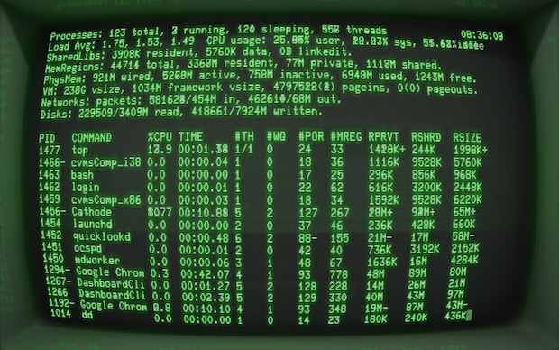
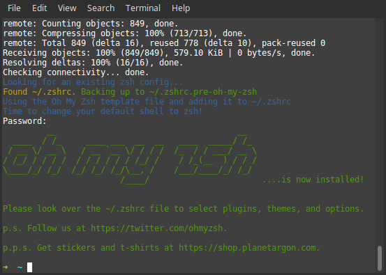
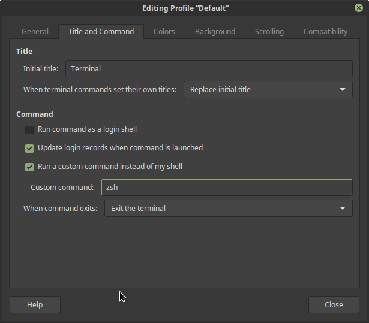
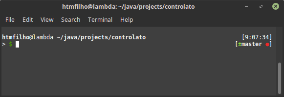

[Zsh] (Z shell) defines itself as a "Shell with lots of features". Indeed, it's a tool to enhance the shell's capabilities. Indispensable for those working in Unix-based systems. To make Zsh simpler, there is [Oh-My-Zsh], a framework for managing Zsh configuration using the theme concept. The goal of this post is to get you all set with Oh-My-Zsh on your Debian Linux system.

<!-- more -->

To start, let's install Zsh:

    $ sudo apt-get install zsh
    $ zsh --version

You may see a version equal to or greater than 5.1.1. The next step is the installation of Oh-My-Zsh:

    $ sh -c "$(wget https://raw.github.com/robbyrussell/oh-my-zsh/master/tools/install.sh -O -)"

After the installation script finishes, the command prompt may look different. It means Oh-My-Zsh was successfully installed. If the prompt looks too minimalistic, don't panic. Oh-My-Zsh accepts themes, and this is just the default one: **robbyrussell**. To change it, go to the home folder, edit the hidden file `.zshrc`, and change the variable `ZSH_THEME` to **bureau**, which is my favourite theme:

    $ cd ~
    $ vim .zshrc
      ...
      ZSH_THEME="bureau"
      ...
    $ source .zshrc

For a complete list of themes, check out the [theme catalogue][theme-catalogue]. Make sure you have some time to spare because trying new themes is addictive.

Oh-My-Zsh won't start by default. To activate it, we have to type `$ zsh` every time we open a new terminal. If you are convinced that Oh-My-Zsh is your thing, you can make sure it is always available. On the terminal window, select **Edit > Profile Preferences** in the menu. In the new window, go to the tab **Title and Command**, select the field **Run a custom command instead of my shell** and type `zsh` in the **Custom command** field. Restart the terminal to see it in action.

What I love about Oh-My-Zsh is its integration with Git, the smart auto-complete, and all the information it shows in a single prompt. The theme **bureau** shows:

* **my location**, so I don't have to type `pwd` all the time

* **the time**, which is useful to know how long the last operation took by comparing the time of the subsequent prompt

* **the current branch** and its **state** with a rich set of colourful symbols, when I'm in a Git repository.

Defining and loading environment variables is also a pleasure. All we have to do is create a file in the ZSH custom folder with the bash script we want to execute:

    $ cd $ZSH_CUSTOM
    $ touch env.zsh

Open the `env.zsh` file and add the script, in this case, the definition of environment variables:

    export PATH=$PATH:/usr/local/go/bin

Finally, we can close the terminal window and open a new one to apply our changes.

Please comment below with your questions, thoughts, and which theme suits you best.

[Oh-My-Zsh]: http://ohmyz.sh
[theme-catalog]: https://github.com/robbyrussell/oh-my-zsh/wiki/Themes
[Zsh]: http://www.zsh.org
